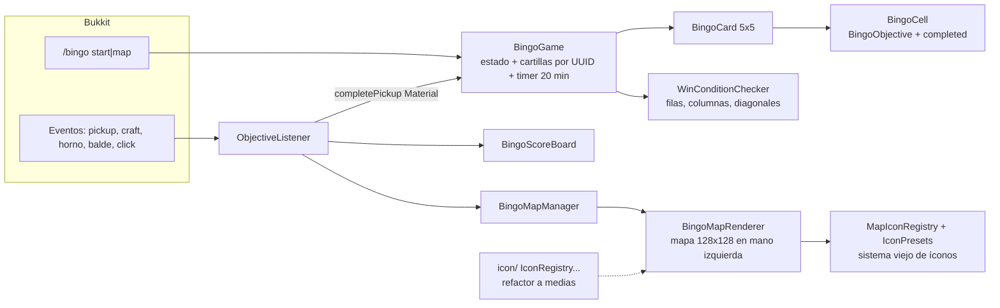
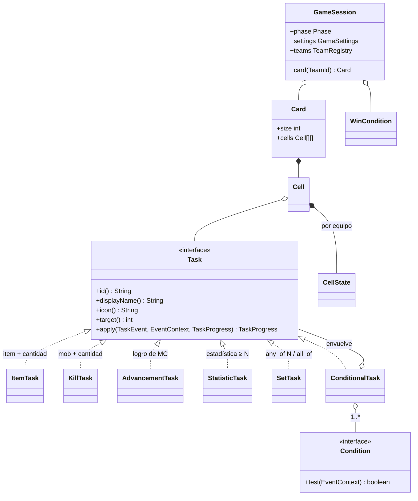
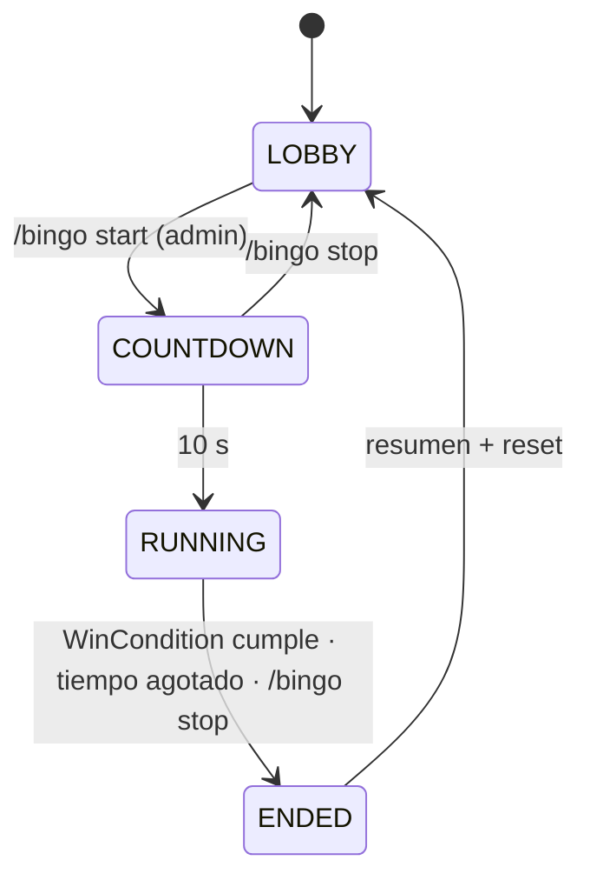
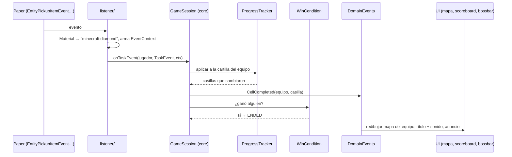

# Arquitectura — AdaptiveBingo (BingoMC)

Este documento describe **cómo está hoy** el plugin y **a dónde va**. El orden de trabajo para llegar
está en [`PLAN.md`](PLAN.md); el diagnóstico y la viabilidad en [`ANALISIS.md`](ANALISIS.md).

## 1. Hoy (v1.0, commit 4705275)

Un solo módulo Maven, paquete `com.shyNkindguy.bingo`, ~1.100 líneas.



Limitaciones de diseño (no son bugs, son lo que impide escalar):

- **Todo gira en torno a `Material`**: una casilla = "tener este ítem". No hay cantidades, mobs, logros
  ni condiciones; `ObjectiveType` existe pero nadie lo usa.
- **Los 25 objetivos están escritos en el código** (`ObjectiveFactory`): no hay pool, ni dificultad, ni
  configuración.
- **La lógica depende de Bukkit**: no se puede probar sin servidor (y el contenedor de Claude no puede
  bajar `paper-api`).
- **Estado plano** (`WAITING/RUNNING/ENDED`) sin lobby, cuenta regresiva ni configuración de partida.
- **Sin equipos**: cada jugador tiene su cartilla; no hay forma de compartir casillas ni de hacer lockout.

## 2. Principios del diseño objetivo

1. **Núcleo puro + adaptador Paper.** La lógica (cartilla, tareas, progreso, condiciones, victoria,
   generador) vive en un módulo `core` **sin dependencias de Bukkit**, probado con JUnit. El módulo
   `plugin` traduce eventos de Paper a eventos del núcleo y pinta la UI. Mismo enfoque que
   [BingoReloaded](https://github.com/Steaf23/BingoReloaded) (`common` + `paper`).
2. **Todo por datos.** Tareas, listas, cartillas, modos y logros se definen en YAML dentro de
   `plugins/AdaptiveBingo/`. El código no tiene objetivos ni textos fijos.
3. **Claves de texto, no enums.** En el núcleo un ítem es `"minecraft:diamond"`, un mob
   `"minecraft:zombie"`, un logro `"minecraft:story/mine_diamond"`. El adaptador convierte desde
   `Material`/`EntityType`/`Advancement`. Así el núcleo no se rompe con cada versión de Minecraft.
4. **Equipos siempre.** Jugar solo = equipo de 1. El progreso se guarda por equipo.
5. **Partida = máquina de estados** con fases explícitas y transiciones probadas.
6. **Eventos de dominio.** El núcleo publica `CasillaCompletada`, `PartidaTerminada`, etc.; la UI, las
   estadísticas y los logros se suscriben. Nada llama a la UI desde la lógica.

## 3. Módulos y paquetes

```
BingoMC/
├── pom.xml                      (padre, Java 21, Paper 1.21.11)
├── core/                        sin Bukkit · tests JUnit · corre en cualquier JVM
│   └── com.shyNkindguy.bingo.core
│       ├── task/                Task, TaskType, ItemTask, KillTask, AdvancementTask,
│       │                        StatisticTask, SetTask (any_of / all_of)
│       ├── condition/           Condition, InDimension, TimeOfDay, InBiome, BelowY, NoDeath, AllOf/AnyOf
│       ├── event/               TaskEvent (sealed): ItemObtained, EntityKilled, AdvancementDone,
│       │                        StatisticChanged · EventContext (dimensión, bioma, hora, Y, muertes)
│       ├── card/                Card (N×N), Cell, CellState
│       ├── catalog/             Catalog, TaskList + Tier, CardSpec, CardGenerator, lector de YAML
│       ├── progress/            ProgressTracker (por equipo), TaskProgress (n/m)
│       ├── win/                 WinCondition: Line, Blackout, Lockout, CompleteX, TimeLimit
│       ├── game/                GameSession, Phase (LOBBY, COUNTDOWN, RUNNING, ENDED), GameSettings
│       ├── team/                Team, TeamId, TeamRegistry
│       ├── bus/                 DomainEvents (CellCompleted, GameEnded, TeamEliminated)
│       └── meta/                (Fase 3) PlayerProfile, Achievement, ItemSet, PlayerStatus
└── plugin/                      Paper 1.21.11 · depende de core
    └── com.shyNkindguy.bingo
        ├── AdaptiveBingo        arranque: carga config, crea servicios, registra listeners/comandos
        ├── command/             /bingo start|stop|card|team|settings|reload|stats
        ├── config/              CatalogService (tasks/ + cards.yml), SettingsLoader, Messages (messages.yml)
        ├── listener/            traducen eventos de Paper → TaskEvent (+ EventContext)
        ├── adapter/             Keys (Material ↔ "minecraft:..."), Teleport, WorldBorder
        ├── ui/map/              BingoMapRenderer (contextual), MapManager, icon/
        ├── ui/                  CardMenu (GUI), ScoreboardView, BossBarView, Feedback (títulos/sonidos)
        └── storage/             (Fase 3) StatsRepository: YAML → SQLite
```

Desde la tarea 1.1 el repo ya tiene esta forma: `core/` (hoy `task/`, `event/`, `progress/`, `card/`,
`catalog/` y `win/`) y `plugin/` (con `adapter/Keys` y `config/CatalogService`). Los paquetes que faltan
se crean así a medida que llegan sus tareas.

## 4. Modelo de dominio



- **`Task.apply`** recibe un evento y devuelve el progreso nuevo (inmutable). Desde la tarea 1.2 existe
  como `apply(TaskEvent, TaskProgress)` en `core/task`; el `EventContext` se suma con las condiciones (1.5). Un `ItemTask` de
  "16 troncos de roble" avanza con `ItemObtained("minecraft:oak_log", total=…)`; un `KillTask` con
  `EntityKilled`; un `SetTask any_of 3` recuerda qué miembros ya cumplió.
- **`ConditionalTask`** = tarea + condiciones: "cocina carne **en el Nether**", "mata un zombi **de
  noche**", "consigue un diamante **sin morir**". Las condiciones son las mismas piezas que después usan
  los logros (Fase 3).
- **`CellState`**: `PENDIENTE`, `EN_PROGRESO(n/m)`, `COMPLETADA(equipo, segundo)`, `BLOQUEADA` (lockout).
- **`WinCondition`** (estrategia): `Line(n)` (n líneas), `Blackout` (carta llena), `Lockout` (la casilla
  es del primero; gana la mayoría y se elimina a quien ya no alcanza), `CompleteX(n)`, `TimeLimit` (al
  acabar el tiempo gana quien tenga más; empate → desempate o muerte súbita).
- **Fases** de `GameSession`:



## 5. Flujo de un evento



Detección de ítems: en vez de mirar el ítem clicado (hoy se puede marcar una casilla con solo hacer
clic en un cofre), el listener revisa **el inventario del jugador** un tick después de pickup, craft,
horno, balde o clic, y emite `ItemObtained` con el total real.

## 6. Configuración por datos (YAML)

Así se leen desde las tareas 1.3 y 1.4 (`tipo` por defecto `item`, también en español: `matar`, `logro`,
`estadistica`; `cantidad` por defecto 1; `id` por defecto `<tipo>:<qué>`; `icono` opcional); los conjuntos y
las condiciones llegan en la 1.5:

```yaml
# plugins/AdaptiveBingo/tasks/basicos.yml
lista: basicos
tier: D
tareas:
  - { item: oak_log, nombre: Tronco de roble, cantidad: 16 }
  - { item: bread, nombre: Pan }
  - { tipo: matar, mob: zombie, nombre: Zombi, cantidad: 3, icono: zombie_head }

# plugins/AdaptiveBingo/tasks/dificiles.yml
lista: dificiles
tier: S
tareas:
  - { item: diamond, nombre: Diamante, cantidad: 3 }
  - { tipo: logro, logro: story/enter_the_nether, nombre: Entrar al Nether }
  - { tipo: any_of, nombre: "3 lanas distintas", necesita: 3,                # 1.5
      de: [white_wool, red_wool, blue_wool, yellow_wool, black_wool] }
  - { item: cooked_beef, nombre: Filete en el Nether, condiciones: [ { dimension: the_nether } ] }  # 1.5
  - { tipo: estadistica, estadistica: jump, nombre: Saltos, cantidad: 500 }
  - { tipo: estadistica, estadistica: mine_block, de: stone, nombre: Piedra picada, cantidad: 64 }
```

```yaml
# plugins/AdaptiveBingo/cards.yml — cuántas tareas salen de cada lista
por_defecto: normal
cartillas:
  normal:
    tamaño: 5                      # de 3 a 7
    listas:
      basicos:   { min: 8, max: 12 }
      medios:    { min: 8, max: 14 }
      dificiles: { min: 2, max: 4 }
  rapida:
    tamaño: 3
    listas: { basicos: { min: 5, max: 7 }, medios: { min: 2, max: 4 } }
```

El generador (`CardGenerator`) elige con semilla (`/bingo start [cartilla] [semilla]`: partidas
repetibles), sin repetir tareas (los ids son únicos en todo el catálogo), respetando los mínimos y
máximos de cada lista (idea de las listas de BingoReloaded y los tiers S–D de
[minecraft-bingo](https://github.com/Extremelyd1/minecraft-bingo)). Todo se valida al leer: un error
en `/bingo reload` dice archivo y tarea ("tasks/basicos.yml, tarea 3: falta nombre") y deja el
catálogo anterior.

## 7. Capa de servidor (Fase 3, encima del bingo)

Todo se cuelga de `DomainEvents`; el bingo no sabe que existe.

| Pieza | Qué es | Reutiliza |
|---|---|---|
| `PlayerProfile` + `StatsRepository` | partidas, victorias, casillas, mejor tiempo por jugador; YAML primero, SQLite después (misma interfaz) | eventos `GameEnded`, `CellCompleted` |
| `Achievement` (logros propios) | `achievements.yml`: disparador + condiciones ("gana 5 partidas", "carta llena en < 30 min", "lockout sin morir") | `Condition` del núcleo |
| Ítems especiales | ítems marcados con `PersistentDataContainer` (reroll de casilla, brújula al bioma, escudo anti-PvP) para un modo "Caos" | `Task`/`SetTask` para entregarlos como recompensa |
| Conjuntos de objetos | llevar N piezas marcadas da un bonus | `SetTask` (all_of) para la detección |
| Estados del jugador (`PlayerStatus`) | modificadores de partida o recompensa: velocidad, visión nocturna, sin hambre | se aplican al entrar a `RUNNING` y se quitan en `ENDED` |

## 8. UI/UX

- **Mapa en la mano izquierda** (lo propio de este plugin, sin resource pack): renderer contextual por
  jugador que solo redibuja cuando su cartilla cambia; íconos 8×8 desde un solo `IconRegistry`;
  casilla con progreso ("3x"), bloqueada en gris (lockout), color del equipo que la tomó.
- **GUI de la cartilla** (`/bingo card`): inventario 6×9 con el ítem de cada casilla y lore de progreso.
- **Scoreboard** sin parpadeo (líneas con `Team` en vez de reiniciar puntajes), **bossbar** con el tiempo,
  **título + sonido** al completar, anuncio global con el color del equipo.
- **Textos en `messages.yml`** (español por defecto), nunca en el código.
